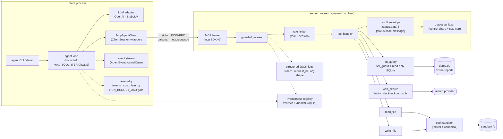

# Architecture

A production-shaped **Model Context Protocol (MCP) server + agent client**
in Python. The server exposes four guarded tools over stdio; the client is
an autonomous agent that discovers them at runtime and drives an
OpenAI-compatible tool-calling loop — tool calling over an open protocol,
not framework bindings.

## Component view

## Surfaces

| Surface | Module | Responsibility | Trust boundary |
|---|---|---|---|
| MCP transport | `server/app.py`, `server/__main__.py` | stdio server, tool registration | stdout = protocol frames only; logs → stderr |
| Invocation pipeline | `server/invocation.py` | rate limit → handler → envelope → sanitize → log + metrics | every call, no exceptions across the wire |
| Tools | `server/tools/` | `web_search`, `db_query`, `read_file`, `write_file` | tool output is untrusted data (LLM01) |
| Guardrails | `server/guardrails/` | path sandbox, read-only SQL, sanitize, rate limit | reject → typed error envelope, counted |
| Client transport | `client/mcp_client.py`, `client/server_spawn.py` | spawn server, env allow-list, `tools/list` → OpenAI defs | `OPENAI_API_KEY` never reaches the server env |
| Agent loop | `client/agent_loop.py` | LLM ⇄ tools, `max_iterations` bound, malformed-call recovery, `RUN_BUDGET_USD` cost gate | tool failures fed back as messages |
| Events | `client/events.py` | `AgentEvent` union, camelCase wire keys, `final` carries `usage`/`costUsd`/`durationMs` | parity with the oracle SSE fixture |
| Config | `config.py` | typed `Settings`, empty string = absent | secrets are `SecretStr`, redacted in logs |
| Observability | `observability/` | structlog + contextvars request IDs, Prometheus, committed model price table | dedicated registry per component |
| Entry points | `cli.py`, `scripts/demo.py`, `server/__main__.py` | `mcp-toolkit-agent`, demo, `mcp-toolkit-server` | CLI reconfigures streams to UTF-8 |

## Key flows

**Tool call:** client generates a `request_id` per call → sent as
`params._meta.requestId` → server extracts it in `guarded_invoke`, binds
it to the log context, and emits one `tool_invocation` record with the
same ID — the correlation chain visible in the client log, the event
stream, and the server log.

**Guardrail block:** a guardrail raises `ToolError(code, guardrail=…)` →
envelope `{status:"error",code}` with `isError=true` →
`mcp_guardrail_blocks_total{guardrail}` increments → the model sees the
typed error and can adapt.

**Termination:** the loop ends on a tool-call-free LLM response
(`terminated_by="answer"`), at `MAX_TOOL_ITERATIONS`
(`"iteration_limit"`) or when accumulated LLM cost reaches
`RUN_BUDGET_USD` (`"budget_limit"`) — guaranteed termination, recorded
in `agent_runs_total`.

**Telemetry:** every `final` event reports `durationMs`, provider
`usage` (prompt/completion/total tokens) and `costUsd` — cost is only
reported when the model has a price (committed table in
`observability/pricing.py`, overridable via `MODEL_PRICING_JSON`),
never estimated as $0. Scorecards and A/B evidence roll these up as
`avgTotalTokens`/`avgCostUsd`/`avgDurationMs` — informational deltas
that never gate promotion.
